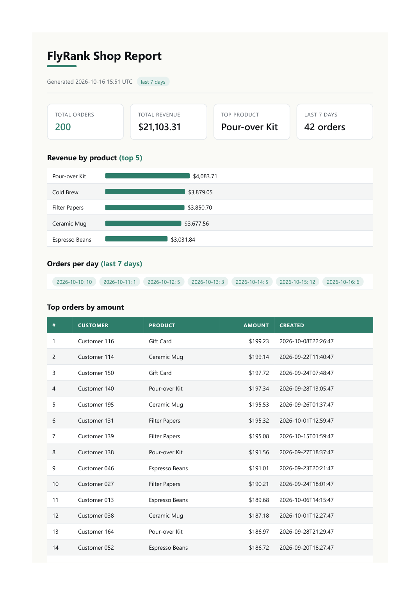

# FlyRank A8 - PDF report generator

A small backend service that turns SQLite data into a PDF report and hands out a
**link** to the file. Only the link crosses the wire - the PDF itself lives on disk.

Pipeline: `orders` table (SQLite) -> one SQL aggregation pass -> HTML template ->
headless-browser print -> `reports/<id>.pdf` on disk -> `GET /reports/<id>/file`
streams it back.

## Lane note (.NET)

The assignment offers a JavaScript lane (Express + `node:sqlite`) and a Python lane
(FastAPI + `sqlite3`). This build uses **.NET 9 (ASP.NET Core Minimal API)** instead;
the pipeline maps one-to-one:

| Brief (JS / Python) | This build (.NET 9) |
|---|---|
| `node:sqlite` / `sqlite3` | `Microsoft.Data.Sqlite` |
| Express `res.sendFile` / FastAPI `FileResponse` | `Results.File(...)` |
| Playwright `page.pdf()` | `Microsoft.Playwright` (`channel: msedge`), with an Edge `--headless --print-to-pdf` fallback |
| `node-cron` / APScheduler (stretch) | `BackgroundService` (stretch) |

Everything the brief grades - SQL aggregation, HTML-to-PDF, storing the file and
serving it **by link**, once-per-day idempotency - is language-independent.

## Dataset

`orders` in `report.db` has `id, customer, product, amount, created_at`.
`POST /seed` fills it with exactly **200 random orders** across 6 products
(Espresso Beans, Cold Brew, Ceramic Mug, Pour-over Kit, Filter Papers, Gift Card),
amounts 5.00-200.00, dates spread over the last 30 days. Seeding is idempotent: it
deletes existing rows first, so running it twice leaves exactly 200.

## Run

```bash
dotnet build src/ReportApi
dotnet run --project src/ReportApi --urls http://localhost:5188
```

Then, in another shell:

```bash
curl -s http://localhost:5188/health
curl -s -X POST http://localhost:5188/seed
curl -s -X POST http://localhost:5188/reports
curl -s -o report.pdf http://localhost:5188/reports/<id>/file
```

## Endpoints

| Method | Path | Purpose |
|--------|------|---------|
| GET  | `/health`             | Liveness check, returns `{"status":"ok"}` |
| POST | `/seed`               | Reseeds exactly 200 random orders (idempotent) |
| GET  | `/report-data`        | The four aggregation result sets as JSON. `?days=N` sets the per-day window (default 7) |
| POST | `/reports`            | Runs the pipeline synchronously, returns `201` with `{id, file}` (or `200` if today's report already exists). Body `{"force":true,"days":N}` |
| POST | `/reports/background` | Queues the render, returns `202` with `{id, status:"pending", file}` |
| GET  | `/reports`            | Lists all reports newest-first: `[{id, createdAt, status, file}]` |
| GET  | `/reports/{id}`       | The stored report record as JSON, incl. `status` and `days` (404 if unknown) |
| GET  | `/reports/{id}/file`  | The PDF bytes from disk (`application/pdf`) |

## The aggregation SQL

```sql
-- 1. total orders
SELECT COUNT(*) FROM orders;

-- 2. total revenue
SELECT SUM(amount) FROM orders;

-- 3. top 5 products by revenue
SELECT product, SUM(amount) AS revenue
FROM orders
GROUP BY product
ORDER BY revenue DESC
LIMIT 5;

-- 4. orders per day, last 7 days
SELECT date(created_at) AS day, COUNT(*) AS orders
FROM orders
WHERE date(created_at) >= date('now','-6 days')
GROUP BY day
ORDER BY day;
```

## Proof (curl transcript)

```
$ curl -s -X POST http://localhost:5188/reports
{"id":"20261016-155147-975c09","file":"/reports/20261016-155147-975c09/file"}      # HTTP 201

$ curl -s -X POST http://localhost:5188/reports
{"id":"20261016-155147-975c09","file":"/reports/20261016-155147-975c09/file"}      # HTTP 200, SAME id -> no new file

$ curl -s -X POST -d '{"force":true}' http://localhost:5188/reports
{"id":"20261016-155150-09483e","file":"/reports/20261016-155150-09483e/file"}      # HTTP 201, new id

$ curl -s -X POST -d '{"force":true,"days":30}' http://localhost:5188/reports
{"id":"20261016-155154-f7ca0b","file":"/reports/20261016-155154-f7ca0b/file"}      # HTTP 201, 30-day window

$ curl -s -X POST http://localhost:5188/reports/background
{"id":"20261016-155156-d74c1a","status":"pending","file":"/reports/20261016-155156-d74c1a/file"}   # HTTP 202

$ curl -s http://localhost:5188/reports/20261016-155156-d74c1a
{"id":"20261016-155156-d74c1a","path":"...\\reports\\20261016-155156-d74c1a.pdf","createdAt":"2026-10-16T15:51:56","status":"done","days":7}

$ curl -s -o report.pdf -w "%{http_code} %{content_type} %{size_download}\n" \
    http://localhost:5188/reports/20261016-155147-975c09/file
200 application/pdf 53866
```

Two same-day POSTs produced **one** file; `force` produced a second; the PDF is **3 A4
pages**, the header row repeats on every page, and no row is cut across a page boundary.

## Screenshot (page 1)



## When to move generation out of the request

You would move generation into a background job once PDF rendering is slow or
bursty enough that holding the HTTP request open (and a worker thread) for the
whole render hurts latency or throughput - e.g. large reports, many concurrent
requests, or retries - so the request can return `202 Accepted` with a status URL
and the job writes the PDF and flips the record to "ready" when done. This build
ships exactly that as a stretch - see `POST /reports/background` below.

## Duplicate requests & `force`

A duplicate request should not produce a second file because the report for a
given day is the same artifact, so regenerating it wastes CPU and disk and leaves
the caller with two links to identical content - returning the existing id keeps
the day's report a single, stable resource.

`force` is for the case where you deliberately want a fresh render anyway - for
example after the underlying data changed, or to re-run the pipeline on demand -
so `{"force":true}` bypasses the once-per-day check and always generates a new report.

## Extras & stretches

Beyond the required stages:

**Extras**
- **Report window** - `?days=N` (default 7, clamped 1..365) parameterises the "orders
  per day" aggregation, on both `GET /report-data` and report generation (`{"days":N}`
  in the POST body or `?days=N`), and the chosen window is printed in the PDF and stored
  on the report row.
- **Report listing** - `GET /reports` returns every generated report newest-first.
- **Pretty PDF** - a title block (generated-at + window), stat cards for total orders /
  revenue / top product, revenue bars, and day pills - while keeping the print-safe
  rules (`thead` repeats, rows never split).

**Stretches**
- **Background job** - `POST /reports/background` writes a `pending` row, enqueues its
  id on an unbounded `System.Threading.Channels.Channel<string>`, and returns `202`. A
  hosted `ReportWorker` renders it and flips the status to `done` (or `failed`). On
  startup the worker re-enqueues anything still `pending`, so a restart does not strand a
  report. The synchronous `POST /reports` (201 + link) is unchanged - it stays the path
  the brief grades.
- **Weekly cron** - a hosted `WeeklyReportJob` computes the next Monday 08:00 local and
  generates a fresh report then, logging each step. The schedule is computed manually
  (no scheduler package). Verified at startup: `Weekly report scheduled for 10/19/2026
  08:00:00 (local)`.
- **Email the link** - after any generation (sync, background, or weekly) the service
  emails the report **link** (never the PDF) over SMTP. Point it at any local catcher,
  e.g. Mailpit:

  ```bash
  mailpit --smtp 127.0.0.1:1025          # watch mail at http://127.0.0.1:8025
  ```

  Config lives under `Smtp` in `appsettings.json` (`Host`, `Port`, `From`, `To`,
  `BaseUrl`, `Enabled`). If SMTP is unreachable the send is logged and swallowed - an
  email failure never breaks report generation.

Verified end-to-end: `POST /reports/background` returned `202 pending`, the row came back
`done`, and Mailpit captured an email per generation, each carrying the absolute link
`http://localhost:5188/reports/<id>/file`.

## Project layout

```
src/ReportApi/
  Program.cs         minimal API + endpoint wiring
  Db.cs              SQLite connection + schema (+ status/days migration)
  Seeder.cs          idempotent 200-order seed
  ReportQueries.cs   the four aggregation queries + getReportData(days)
  HtmlReport.cs      the HTML report template + print CSS
  PdfRenderer.cs     HTML -> PDF (Playwright msedge, Edge-headless fallback)
  ReportGenerator.cs render + record + notify
  ReportQueue.cs     unbounded Channel<string> for the background job
  ReportWorker.cs    BackgroundService that renders queued reports
  WeeklyReportJob.cs BackgroundService: Monday 08:00 weekly report
  MailSender.cs      emails the report link (never the attachment)
ai-version/          the blind one-shot AI build + AI-VS-ME.md (Stage 7)
reports/             generated PDFs (gitignored)
report.db            SQLite database (gitignored)
```

## Requirements checklist

- [x] `report.db` + seed fills it with 200 orders, even when run twice
- [x] One set of aggregation queries (two totals, top 5, grouped breakdown) - pasted above
- [x] PDF is >= 2 pages, no row cut, header repeats
- [x] `POST /reports` -> 201 + id + file link; `GET /reports/{id}`; unknown -> 404
- [x] File served from disk by link; JSON never carries bytes
- [x] Duplicate requests make one file (same id, one PDF); `force` overrides
- [x] Public repo, >= 7 commits, README with commands/SQL/proof/screenshot; `reports/` + `report.db` gitignored
